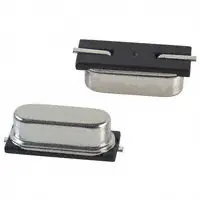

>For my design, the selected components are the **DFR0154 LCD Display** and the **PEC11-4215F-S24 Rotary Encoder**.

>The DFR0154 LCD display was selected because of its simple pinout and ease of use. Its serial communication interface reduces the number of connections required between the display and the PIC18F57Q43 microcontroller.

>The PEC11-4215F-S24 rotary encoder was selected because of its unlimited rotation and larger physical size compared to the other rotary encoder options. Its continuous rotation makes it well suited for navigating menus and adjusting settings through the human-machine interface.

>Additionally, our design will incorporate two pushbuttons for operating the human-machine interface.

## Display Module

The display module will provide a visual interface for the user, allowing information and settings to be displayed.

**External Clock Module**

1. XC1259TR-ND surface mount crystal

    

    * $1/each
    * [link to product](http://www.digikey.com/product-detail/en/ECS-40.3-S-5PX-TR/XC1259TR-ND/827366)

    | Pros                                      | Cons                                                             |
    | ----------------------------------------- | ---------------------------------------------------------------- |
    | Inexpensive                               | Requires external components and support circuitry for interface |
    | Compatible with PSoC                      | Needs special PCB layout.                                        |
    | Meets surface mount constraint of project |

1. CTX936TR-ND surface mount oscillator

    

    * $1/each
    * [Link to product](http://www.digikey.com/product-detail/en/636L3I001M84320/CTX936TR-ND/2292940)

    | Pros                                                              | Cons                |
    | ----------------------------------------------------------------- | ------------------- |
    | Outputs a square wave                                             | More expensive      |
    | Stable over operating temperature                                 | Slow shipping speed |
    | Direct interface with PSoC (no external circuitry required) range |

**Choice:** Option 2: CTX936TR-ND surface mount oscillator

**Rationale:** A clock oscillator is easier to work with because it requires no external circuitry in order to interface with the PSoC. This is particularly important because we are not sure of the electrical characteristics of the PCB, which could affect the oscillation of a crystal. While the shipping speed is slow, according to the website if we order this week it will arrive within 3 weeks.
