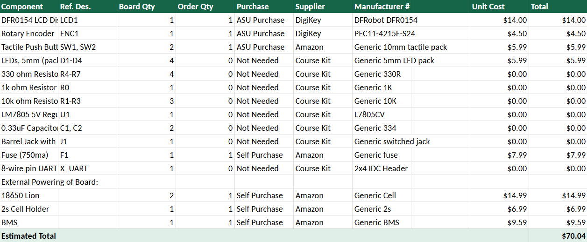

## Overview
This will include everything that will be purchased for my portion of our RAS 304 Project.

## Bill of Materials Example (as Table)

 

## Component Bill of Materials

| Component | Ref. Des. | Board Qty | Order Qty | Purchase | Supplier | Manufacturer # | Unit Cost | Total |
|---|---|---:|---:|---|---|---|---:|---:|
| DFR0154 LCD Display, 20x4 I2C | LCD1 | 1 | 1 | ASU Purchase | DigiKey | DFRobot DFR0154 | $14.00 | $14.00 |
| Rotary Encoder | ENC1 | 1 | 1 | ASU Purchase | DigiKey | PEC11-4215F-S24 | $4.50 | $4.50 |
| Tactile Push Buttons (pack) | SW1, SW2 | 2 | 1 | ASU Purchase | Amazon | Generic 10mm tactile pack | $5.99 | $5.99 |
| LEDs, 5mm (pack) | D1-D4 | 4 | 0 | Not Needed | Course Kit | Generic 5mm LED pack | $5.99 | $5.99 |
| 330 ohm Resistors | R4-R7 | 4 | 0 | Not Needed | Course Kit | Generic 330R | $0.00 | $0.00 |
| 1k ohm Resistor | R0 | 1 | 0 | Not Needed | Course Kit | Generic 1K | $0.00 | $0.00 |
| 10k ohm Resistors | R1-R3 | 3 | 0 | Not Needed | Course Kit | Generic 10K | $0.00 | $0.00 |
| LM7805 5V Regulator | U1 | 1 | 0 | Not Needed | Course Kit | L7805CV | $0.00 | $0.00 |
| 0.33uF Capacitors | C1, C2 | 2 | 0 | Not Needed | Course Kit | Generic 334 | $0.00 | $0.00 |
| Barrel Jack with Switch | J1 | 1 | 0 | Not Needed | Course Kit | Generic switched jack | $0.00 | $0.00 |
| Fuse (750mA) | F1 | 1 | 1 | Self Purchase | Amazon | Generic fuse | $7.99 | $7.99 |
| 8-wire pin UART header | X_UART | 1 | 0 | Not Needed | Course Kit | 2x4 IDC Header | $0.00 | $0.00 |
| **External Powering of Board** | | | | | | | | |
| 18650 Li-ion | | 2 | 1 | Self Purchase | Amazon | Generic Cell | $14.99 | $14.99 |
| 2S Cell Holder | | 1 | 1 | Self Purchase | Amazon | Generic 2S | $6.99 | $6.99 |
| BMS | | 1 | 1 | Self Purchase | Amazon | Generic BMS | $9.59 | $9.59 |
| **Estimated Total** | | | | | | | | **$70.04** |
