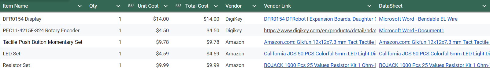

## Overview
This will include everything that will be purchased for my portion of our RAS 304 Project.

## Bill of Materials Example (as Table)

 

## Component Bill of Materials

| Component | Qty | Unit Cost | Total Cost | Vendor | Purchase Link | Datasheet |
|---|---:|---:|---:|---|---|---|
| DFR0154 Display | 1 | $14.00 | $14.00 | DigiKey | [View Product](https://www.digikey.com/en/products/detail/dfrobot/DFR0154/7597130) | [View Datasheet](https://mm.digikey.com/Volume0/opasdata/d220001/medias/docus/800/DFR0154_Web.pdf) |
| PEC11-4215F-S24 Rotary Encoder | 1 | $4.50 | $4.50 | DigiKey | [View Product](https://www.digikey.com/en/products/detail/adafruit-industries-llc/377/7902287) | [View Datasheet](https://mm.digikey.com/Volume0/opasdata/d220001/medias/docus/2187/377_Web.pdf) |
| Tactile Push Button Momentary Set | 1 | $9.78 | $9.78 | Amazon | [View Product](https://www.amazon.com/dp/B01E38OS7K) | [View Datasheet](https://www.amazon.com/dp/B01E38OS7K) |
| LED Set | 1 | $4.59 | $4.59 | Amazon | [View Product](https://www.amazon.com/dp/B0CR886L92) | [View Datasheet](https://www.amazon.com/dp/B0CR886L92) |
| Resistor Set | 1 | $9.99 | $9.99 | Amazon | [View Product](https://www.amazon.com/dp/B08FD1XVL6) | [View Datasheet](https://www.amazon.com/dp/B08FD1XVL6) |
| **TOTAL** | | | **$42.86** | | | |

**Total estimated cost: $42.86**
