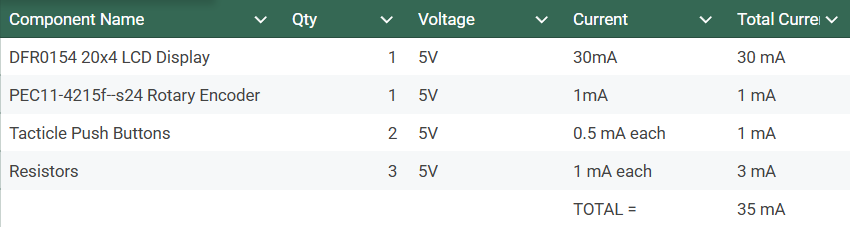

## Overview
> I created the brains of our project. This means my total power consumption is actually very low as I only power the HMI from my board.

## Power Budget

| Component | Qty | Voltage | Current per Unit | Total Current |
|---|---:|---:|---:|---:|
| DFR0154 20x4 LCD Display | 1 | 5V | 30 mA | 30 mA |
| PEC11-4215F-S24 Rotary Encoder | 1 | 5V | 1 mA | 1 mA |
| Tactile Push Buttons | 2 | 5V | 0.5 mA each | 1 mA |
| Resistors | 3 | 5V | 1 mA each | 3 mA |
| **Total** | | | | **35 mA** |

## Resouces

The power budget and bill of materials are within this Microsoft Excel Sheet [*here*](RAS304.xlsx).
