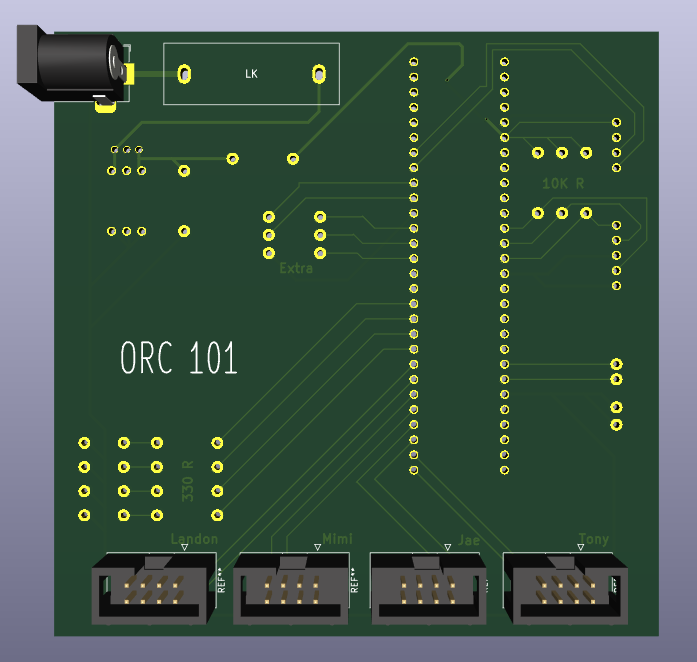
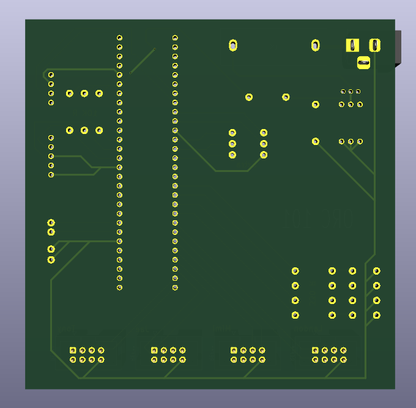

## Overview

This PCB is designed to support our teams robot as a central control unit and human machine interface.

-----
The front of the PCB : 
-----
The front of the PCB: 
-----

## Resources

The PCB report as a PDF download is available [*here*](DFM_Report.pdf).